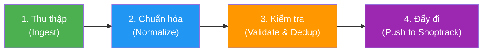
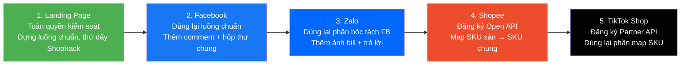

# 🔄 PHÂN TÍCH ĐỀ TÀI ĐATN MỚI: HỆ THỐNG GOM ĐƠN ĐA NỀN TẢNG
> **Trạng thái**: Đề tài mới do GVHD giao thay thế đề tài BĐS Lakehouse cũ.  
> **Nguồn**: File PDF [gom đơn đa nền tảng.pdf](./gom%20đơn%20đa%20nền%20tảng.pdf)  
> **Ngày phân tích**: 2026-10-05

---

## 1. BẢN CHẤT ĐỀ TÀI – XÂY DỰNG CÁI GÌ VÀ ĐỂ LÀM GÌ?

### 1.1. Bài toán thực tế
Các shop bán hàng online tại Việt Nam hiện đang bán trên **5 kênh đồng thời**:

| Kênh | Khách để lại gì | Cách lấy dữ liệu về |
| :--- | :--- | :--- |
| **Landing Page** | Form khách tự điền | Form gửi thẳng về hệ thống |
| **Facebook** | Comment bài viết/Live, Messenger | Webhook Fanpage, bóc SĐT & địa chỉ |
| **Zalo OA** | Tin nhắn, ảnh bill chuyển khoản | Webhook Zalo OA, bóc tên/SĐT/địa chỉ |
| **Shopee** | Đơn đặt trên sàn | Shopee Open API |
| **TikTok Shop** | Đơn qua video/live | TikTok Partner API |

**Vấn đề hiện tại (Pain Point)**:
1. **Nhập tay từng đơn**: Mỗi kênh một giao diện, nhân viên phải mở từng nơi để sao chép sang Shoptrack (phần mềm quản lý bán hàng).
2. **Dễ sai và sót đơn**: Nhầm SĐT, địa chỉ hoặc bỏ sót đơn khi chốt nhiều đơn cùng lúc.
3. **Một khách, nhiều hồ sơ**: Khách mua ở nhiều kênh bị tách thành nhiều khách khác nhau trong Shoptrack.

### 1.2. Mục tiêu đề tài
**Xây dựng Hệ thống Gom đơn Đa nền tảng (Multi-channel Order Consolidation System)** có khả năng:
* **Tự động thu thập** đơn hàng, tin nhắn, bình luận từ 5 kênh bán hàng.
* **Chuẩn hóa** dữ liệu đầu vào (bóc tên, SĐT, địa chỉ, sản phẩm) về một mẫu chung duy nhất.
* **Kiểm tra & Khử trùng**: Gộp khách trùng theo SĐT, map SKU, chặn đơn trùng.
* **Đẩy tự động** khách hàng + đơn hàng + hội thoại vào **Shoptrack** qua API.
* **Gửi câu trả lời** từ Shoptrack ngược lại về Facebook và Zalo (Hộp thư chung 2 chiều).

---

## 2. KIẾN TRÚC HỆ THỐNG TỔNG QUAN

### 2.1. Luồng dữ liệu chính (Data Flow)

```
ĐẦU VÀO (5 kênh)          XỬ LÝ (Hệ thống gom đơn)          ĐẦU RA (Shoptrack)
──────────────────    ─────────────────────────────────    ───────────────────────
Landing Page ─────┐   ┌─ 1. Thu thập (Ingest)              Thông tin khách hàng
Facebook ─────────┼──→│  2. Chuẩn hóa (Normalize)     ──→  Đơn hàng
Zalo OA ──────────┤   │  3. Kiểm tra (Validate/Dedup)      Tin nhắn & bình luận
Shopee ───────────┤   └─ 4. Đẩy đi (Push to Shoptrack)
TikTok Shop ──────┘
                       Chiều ngược: Shoptrack → trả lời → Facebook, Zalo
```

### 2.2. Mẫu dữ liệu chuẩn hóa (Unified Schema)

**Thông tin Khách hàng:**
| Trường | Mô tả |
| :--- | :--- |
| `full_name` | Tên người nhận |
| `phone` | **Khóa chính nhận diện khách** (gộp trùng theo SĐT) |
| `address` | Địa chỉ giao hàng đầy đủ |
| `channel_customer_id` | ID Facebook, Zalo hoặc tài khoản sàn |

**Thông tin Đơn hàng:**
| Trường | Mô tả |
| :--- | :--- |
| `order_id` | Kênh nguồn + mã đơn gốc (đảm bảo duy nhất) |
| `products` | Mã SKU chung + số lượng |
| `total_amount` | Tiền hàng, phí ship, thanh toán |
| `notes` | Ghi chú và trạng thái đơn |
| `source` | Kênh, Page/OA, bài viết/chiến dịch |

### 2.3. Pipeline 4 bước cho mọi kênh



> **Lưu ý quan trọng**: Đơn từ **Facebook và Zalo** dừng ở bước 3 dưới dạng **"đơn nháp"** (draft order). Nhân viên kiểm tra và bấm chốt thì đơn mới sang bước 4. Đơn từ **Landing Page, Shopee, TikTok** đi thẳng tự động.

---

## 3. CHI TIẾT XỬ LÝ TỪNG KÊNH

### 3.1. Landing Page (Tự kiểm soát hoàn toàn)
* Khách bấm gửi form → Form gửi kèm mã chiến dịch quảng cáo.
* Hệ thống kiểm tra: SĐT đúng định dạng, có địa chỉ, chặn spam.
* Tạo khách (nhận ra khách cũ theo SĐT) và tạo đơn mới.
* **Đẩy tự động vào Shoptrack**, không cần nhân viên xác nhận.

### 3.2. Facebook (Comment + Messenger, Semi-automated)
**Luồng Comment bài viết/Live:**
* Nhận comment kèm thông tin Page và bài viết → Quét SĐT trong comment → Ẩn comment (chống bị cướp khách) → Nhắn tin mở chat với khách.

**Luồng Messenger:**
* Nhận tin nhắn từ mọi Page → Bóc tên, SĐT, địa chỉ → Tạo đơn nháp điền sẵn → **Nhân viên chốt đơn** ngay trong Shoptrack.
* Tin nhắn của **nhiều Page về chung một hộp thư** trong Shoptrack.

### 3.3. Zalo OA (Semi-automated)
* Khách nhắn Zalo (thông tin mua hàng hoặc ảnh bill chuyển khoản).
* Zalo OA webhook báo về → Xử lý bóc tên, SĐT, địa chỉ → Tạo đơn nháp.
* Nhân viên trả lời khách & xác nhận đơn → Khách + đơn vào Shoptrack.
* Ảnh bill lưu kèm đơn để đối chiếu. Tin Zalo hiện chung hộp thư với Facebook.

### 3.4. Shopee (Tự động hoàn toàn qua API)
* Khách đặt hàng → **Shopee Open API** báo đơn mới → Map mã SKU sàn → SKU chung → Đẩy vào Shoptrack.
* Không cần nhân viên xác nhận, chỉ cần map SKU & đồng bộ trạng thái đơn.

### 3.5. TikTok Shop (Tự động hoàn toàn qua API)
* Khách mua qua video/live → **TikTok Partner API** trả đơn + mã bưu kiện → Map SKU → Đẩy vào Shoptrack.

---

## 4. BỐN QUY TẮC GIỮ DỮ LIỆU SẠCH

| Quy tắc | Mô tả | Cơ chế |
| :--- | :--- | :--- |
| **Một khách, một hồ sơ** | Khách trùng SĐT được gộp vào một hồ sơ dù mua ở kênh nào | Dedup theo `phone` |
| **Một sản phẩm, một mã SKU** | Mã hàng của từng kênh được map về danh mục chung | SKU Mapping Table |
| **Một đơn, một lần đẩy** | Mỗi đơn mang mã kênh + mã gốc, gửi lại cũng không tạo đơn trùng | Idempotent by `source + order_id` |
| **Lỗi thì giữ lại và thử lại** | Đơn đẩy lỗi nằm trong hàng đợi, tự thử lại và báo người phụ trách | Retry Queue + Dead Letter Queue |

---

## 5. LỘ TRÌNH TRIỂN KHAI (THEO PDF CỦA GVHD)



* **Bước 1–3**: Kênh do mình kiểm soát (Landing Page, Facebook, Zalo).
* **Bước 4–5**: Kênh sàn, phụ thuộc API bên ngoài (Shopee, TikTok).
* **Tiêu chí hoàn thành mỗi bước**: Đơn của kênh đó vào Shoptrack **đúng khách, đúng đơn, đúng nguồn, không trùng**.

---

## 6. PHẠM VI ĐỒ ÁN (SCOPE)

### ✅ Trong phạm vi (Nhóm làm):
* Thu thập đơn, tin nhắn, bình luận từ 5 kênh.
* Chuẩn hóa, kiểm tra và gắn nguồn.
* Đẩy khách, đơn, hội thoại vào Shoptrack.
* Gửi câu trả lời từ Shoptrack về Facebook, Zalo.

### ❌ Shoptrack đảm nhiệm (Không nằm trong scope):
* Tồn kho và vận chuyển.
* Màn hình hộp thư, thống kê và báo cáo.

### ❓ Phân tích & Câu trả lời chi tiết cho các thắc mắc về Shoptrack:

#### 1. Shoptrack có API nhận khách, đơn, tin nhắn và gửi tin trả lời không?
* **Câu trả lời**: **CÓ – Đây là yêu cầu bắt buộc đối với kiến trúc Middleware 2 chiều (Bidirectional Integration)**.
* **Chi tiết kỹ thuật**:
  * **Chiều vào (Middleware → Shoptrack)**: Shoptrack cung cấp bộ REST API tiếp nhận dữ liệu đã được chuẩn hóa:
    * `POST /api/v1/customers`: Đẩy thông tin khách hàng đã qua khử trùng.
    * `POST /api/v1/orders`: Đẩy đơn hàng (bao gồm đơn nháp `draft` từ FB/Zalo và đơn tự động `approved` từ Web/Sàn).
    * `POST /api/v1/conversations/messages`: Đẩy tin nhắn Messenger, bình luận Facebook, tin nhắn Zalo vào Hộp thư chung.
  * **Chiều ra (Shoptrack → Middleware → Facebook/Zalo)**: Shoptrack phát Outbound Webhook `POST /webhook/shoptrack/reply` khi nhân viên gõ câu trả lời trên màn hình Hộp thư chung. Middleware nhận sự kiện này, tra cứu đúng Page/OA Token và gọi Graph API/Zalo API gửi tin nhắn lại cho khách.
  * *Phương án dự phòng đồ án*: Nếu Shoptrack của công ty chậm cấp API, ta tự dựng **Mock Shoptrack Server** (FastAPI) với đúng bộ Swagger spec này để tiến độ không bị nghẽn.

#### 2. Trường nào bắt buộc, gồm cả trường nguồn để thống kê?
* **Câu trả lời**: Căn cứ theo mẫu dữ liệu chuẩn (Trang 5 & 12 trong tài liệu GVHD), danh sách trường bắt buộc bao gồm:
  * **Khách hàng**: `phone` (Khóa chính nhận diện), `full_name` (Họ tên), `address` (Địa chỉ giao hàng).
  * **Đơn hàng**: `source_channel` (Kênh bán: `landing_page`, `facebook`, `zalo`, `shopee`, `tiktok`), `source_order_id` (Mã đơn gốc - Idempotency key), `status` (`draft` | `approved`), `items` (`master_sku`, `quantity`, `unit_price`), `total_amount`.
  * **Trường nguồn gắn vào để Shoptrack thống kê (Bắt buộc có trong `source_metadata`)**:
    * **Facebook Comment/Live**: `page_id`, `page_name`, `post_id` (ID bài viết / buổi Live).
    * **Facebook Messenger**: `page_id`, `page_name`.
    * **Zalo**: `zalo_oa_id`, `oa_name`.
    * **Landing Page**: `campaign_id` (Chiến dịch quảng cáo), `utm_source`.
    * **Shopee / TikTok**: `shop_id` (Gian hàng).

#### 3. Khách trùng được nhận diện bằng SĐT hay mã khác?
* **Câu trả lời**: **Khách trùng được nhận diện 100% bằng Số điện thoại (`phone`) làm Khóa chính gộp hồ sơ (Resolution Key)**.
* **Chi tiết kỹ thuật**:
  * Chuẩn hóa SĐT về định dạng 10 chữ số chuẩn VN (ví dụ `0987654321`).
  * Khi gói tin mới về, Middleware truy vấn DB:
    * Nếu SĐT đã tồn tại $\rightarrow$ Lấy `customer_id` cũ, gán đơn mới vào khách cũ (không sinh bản ghi trùng).
    * Đồng thời lưu liên kết ID kênh mới (như Facebook `PSID` hay `Zalo User ID`) vào bảng `customer_identities`.
  * *Xử lý khi chat chưa có SĐT*: Tạm định danh bằng ID kênh (`anonymous_customer`). Ngay khi khách để lại SĐT trong đoạn chat, hệ thống tự động kích hoạt logic hợp nhất (Merge) hồ sơ tạm vào hồ sơ chuẩn theo SĐT.

#### 4. Hộp thư chung có gộp được nhiều Page và Zalo OA không?
* **Câu trả lời**: **HOÀN TOÀN GỘP ĐƯỢC VÀ ĐÂY LÀ YÊU CẦU TRỌNG TÂM CỦA ĐỀ TÀI (Trang 8, 9, 10 trong PDF)**.
* **Chi tiết kỹ thuật**:
  * Hệ thống Middleware hứng Webhook từ nhiều Fanpage khác nhau (Page 1, Page 2, Page Ads...) và Zalo OA.
  * Tất cả tin nhắn/comment được Middleware đóng gói về chung 1 chuẩn `Message Schema` mang thông tin định danh nguồn (`page_id`, `channel_type`) rồi đẩy sang Shoptrack qua API Hộp thư chung.
  * Khi nhân viên Shoptrack gõ câu trả lời, Middleware sẽ đọc `page_id` đính kèm để dùng đúng **Access Token** của Fanpage/OA đó và gửi tin phản hồi đến đúng người nhận.

---

## 7. MA TRẬN 6 BƯỚC ĐÁNH GIÁ ĐỀ TÀI MỚI (THEO CHUẨN PTIT)

### [1] BÀI TOÁN CỐT LÕI & ĐIỂM KHÁC BIỆT
* **Vấn đề thực tế**: Shop bán hàng online phải nhập tay đơn từ 5 kênh khác nhau → sai sót, sót đơn, mất khách, dữ liệu phân mảnh.
* **Điểm thoát bẫy CRUD**: Đề tài KHÔNG chỉ là web quản lý đơn hàng thông thường. Bản chất là một **Integration Platform / Middleware** kết nối 5 kênh bán hàng dị biệt vào một hệ thống trung tâm, với các thách thức kỹ thuật thực sự:
  * Xử lý **Webhook real-time** từ Facebook/Zalo.
  * **NLP/Regex** bóc tách SĐT, tên, địa chỉ từ văn bản tự do (tin nhắn Messenger, Zalo).
  * **Deduplication** khách hàng xuyên kênh.
  * **Idempotent API calls** đảm bảo không đẩy đơn trùng.
  * **Message Queue + Retry** đảm bảo không mất đơn khi Shoptrack lỗi.

### [2] ĐỘ SÂU KỸ THUẬT & KIẾN TRÚC
* **Kiến trúc đề xuất**: Event-driven Microservice / Message Broker Architecture.
* **Thách thức kỹ thuật**:
  * Xử lý concurrent webhook từ nhiều kênh đồng thời.
  * Bóc tách NER (Named Entity Recognition) cho tin nhắn tiếng Việt không cấu trúc.
  * Quản lý OAuth2/App credentials cho 4 nền tảng bên ngoài (Facebook Graph API, Zalo OA API, Shopee Open API, TikTok Partner API).
  * Đảm bảo tính idempotent & at-least-once delivery.

### [3] HỘI ĐỒNG PHẢN BIỆN (Câu hỏi hiểm dự kiến)
1. *"Nếu Facebook thay đổi Webhook API hoặc Shopee đổi Open API thì hệ thống có sụp không?"* → Thiết kế Adapter Pattern, mỗi kênh là một plugin tách rời.
2. *"Thuật toán bóc SĐT và địa chỉ từ tin nhắn Zalo/Messenger có chính xác bao nhiêu %?"* → Cần benchmark Precision/Recall trên tập test thực tế.
3. *"Tại sao không dùng Zapier/Make.com cho tiện?"* → So sánh chi phí, giới hạn rate limit, và khả năng tùy chỉnh luồng xử lý phức tạp.

### [4] TÍNH TOÁN KHẢ THI & NGUỒN LỰC
* **API credentials**: Cần tài khoản Developer Facebook, Zalo, Shopee, TikTok (miễn phí đăng ký sandbox/test mode).
* **Shoptrack API**: Cần liên hệ Shoptrack để xin tài liệu API và test key.
* **Hạ tầng**: Có thể chạy trên VPS nhỏ hoặc Docker local.

### [5] CẤU TRÚC BÁO CÁO 60–100 TRANG
* **Chương 1**: Tổng quan bài toán bán hàng đa kênh, khảo sát hiện trạng shop online VN.
* **Chương 2**: Cơ sở lý thuyết (Webhook, REST API, Message Queue, NER, Deduplication, Idempotent Pattern).
* **Chương 3**: Phân tích & Thiết kế (Use Case, Sequence Diagram cho từng kênh, ERD, Kiến trúc triển khai).
* **Chương 4**: Triển khai thực nghiệm & đánh giá (Demo 5 kênh, đo tỷ lệ bóc tách chính xác, đo throughput).
* **Chương 5**: Kết luận & Hướng phát triển.

### [6] PHÂN CẤP PHẠM VI
* **MVP (7.5–8.0)**: Landing Page + Facebook Messenger → Shoptrack hoạt động end-to-end.
* **Target (8.5–9.0)**: Thêm Zalo OA + hộp thư chung 2 chiều + Shopee API.
* **Stretch (9.5–10)**: Thêm TikTok Shop + Dashboard thống kê nguồn + NLP tự động bóc tách tin nhắn.


