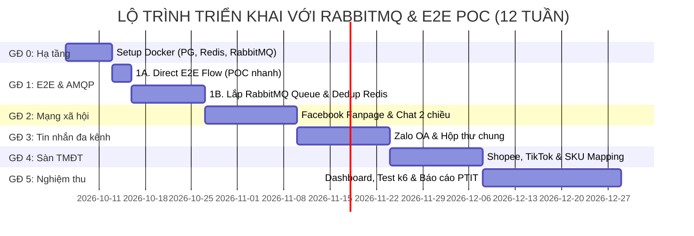

# 🗺️ ROADMAP: HỆ THỐNG GOM ĐƠN ĐA NỀN TẢNG
> **Đề tài**: Xây dựng Hệ thống Gom đơn Đa nền tảng tích hợp ShopTrack  
> **Thời gian**: 10 – 12 tuần  
> **Phần cứng**: Dell Inspiron 3501, 16GB RAM (Thực tế khả dụng: ~5–6GB), Windows 11  
> **Kiến trúc cốt lõi**: **Event-Driven Architecture với RabbitMQ (AMQP) + Redis Cache + PostgreSQL**  
> **Chiến lược tiếp cận**: **E2E POC First** (Chạy thông luồng trước) ➔ **Chuẩn hóa Enterprise Message Queue** (Bảo vệ đồ án PTIT)

---

## 💡 TRIẾT LÝ TRIỂN KHAI & TIẾP THU LỜI KHUYÊN THỰC TẾ

Khi làm đồ án tốt nghiệp, có 2 lời khuyên rất phổ biến:
1. *"Không cần làm Message Queue (MQ) đâu, cứ chạy được cái luồng End-to-End (E2E) là được."*
2. *"Dùng Docker để host server, muốn có tên miền thì trỏ về port Docker là xong."*

### 👉 Phân tích & Cách kết hợp thông minh vào Đồ án:

| Vấn đề | Lời khuyên thực tế | Góc nhìn Hội đồng PTIT | Giải pháp tối ưu trong Roadmap này |
| :--- | :--- | :--- | :--- |
| **RabbitMQ (Message Broker)** | Bỏ qua để đỡ tốn thời gian dựng cấu hình phức tạp | Rất thích vì **RabbitMQ là chuẩn Enterprise kinh điển** (AMQP, Dead Letter Exchange, Routing Key). Chứng minh đề tài vượt xa "Web CRUD gọi API". | **Chiến lược 2 chặng:**<br>• **Chặng 1 (POC - 3 ngày đầu)**: Chạy đồng bộ trực tiếp (FastAPI $\rightarrow$ ShopTrack) để thông luồng, có demo ngay.<br>• **Chặng 1B**: Lắp **RabbitMQ (bản Alpine siêu nhẹ ~250MB)** + **FastStream/aio-pika**. Có sẵn giao diện web quản lý queue (`localhost:15672`) chiếu cho Hội đồng xem. |
| **Redis** | Không cần nếu đã có DB | Cần cho các tác vụ micro-second | Dùng làm **bộ đệm khóa chống đẩy trùng (Idempotency Lock `SETNX`)** và lưu Access Token của FB/Zalo (~40MB RAM). |
| **Docker & Tên miền** | Đóng gói Docker, trỏ tên miền vào port Docker để host | Cần môi trường demo ổn định, có thể truy cập từ xa | **Phân tách 2 môi trường:**<br>• **Dev trên Laptop**: Python chạy native trên Windows (nhẹ mát máy), Docker chỉ chạy 3 container Alpine (Postgres, Redis, RabbitMQ). Webhook dùng **Cloudflare Tunnel** (miễn phí, không tốn tiền mua domain/VPS).<br>• **Host Nghiệm thu (Tuỳ chọn)**: Viết sẵn `Dockerfile` đóng gói toàn bộ server để nếu cần host lên VPS thì chỉ việc trỏ tên miền vào port Docker. |

---

## 1. HỆ THỐNG GỒM NHỮNG GÌ? AI LÀM GÌ?

Hệ thống có **3 tầng chính**:

```
TẦNG 1 – ĐẦU VÀO (5 kênh bán hàng)
     │
     │  Dữ liệu đổ về qua Internet
     │  (Dev: Cloudflare Tunnel / Host: Nginx trỏ port Docker)
     ▼
TẦNG 2 – HỆ THỐNG GOM ĐƠN (Middleware – Phần bạn viết code)
     │  • FastAPI Ingestion Gateway
     │  • RabbitMQ Message Broker (AMQP) + Redis Lock
     │  • Async Worker (Bóc tách Regex, Khử trùng, Map SKU)
     │  • PostgreSQL Database
     │  • Admin Dashboard + RabbitMQ Management Web UI
     │
     │  Đẩy dữ liệu sạch qua REST API
     ▼
TẦNG 3 – SHOPTRACK.VN (Bên thứ 3 – Quản lý đơn & Gọi vận chuyển)
```

---

## 2. BẢN ĐỒ CÔNG CỤ: CÁI NÀO DÙNG CHO VIỆC GÌ?

### TẦNG 1: Nguồn dữ liệu đầu vào (5 kênh bán hàng)

| Kênh | Bạn cần chuẩn bị gì? | Dữ liệu khách để lại | Cách dữ liệu đến hệ thống |
| :--- | :--- | :--- | :--- |
| **Landing Page** | Viết 1 file HTML tĩnh (form đặt hàng) | Họ tên, SĐT, Địa chỉ, SKU sản phẩm | Form bắn thẳng HTTP POST vào FastAPI |
| **Facebook** | Tạo Fanpage test trên [developers.facebook.com](https://developers.facebook.com) | Comment bài viết/Live, tin nhắn Messenger | Facebook tự bắn Webhook (JSON) về máy bạn |
| **Zalo OA** | Tạo Zalo OA test trên [developers.zalo.me](https://developers.zalo.me) | Tin nhắn, ảnh bill chuyển khoản | Zalo tự bắn Webhook (JSON) về máy bạn |
| **Shopee** | Xin tài khoản Sandbox qua GVHD/ShopTrack | Đơn hàng hoàn chỉnh từ sàn | Shopee Open API trả JSON đơn hàng |
| **TikTok Shop** | Xin tài khoản Sandbox qua GVHD/ShopTrack | Đơn hàng + Mã bưu kiện | TikTok Partner API trả JSON đơn hàng |

> 💡 **Vấn đề kết nối Internet cho Webhook**:
> Máy chủ Facebook/Zalo ở nước ngoài, không thể gửi dữ liệu vào `localhost` trên laptop được nếu máy ở sau mạng gia đình/WiFi trường học (NAT).
>
> **Giải pháp tối ưu theo 2 chế độ:**
> 1. **Khi Dev trên Laptop (Khuyên dùng)**: Dùng **Cloudflare Tunnel (`cloudflared`)** — Tải 1 file `.exe` duy nhất, gõ 1 lệnh tạo link HTTPS cố định trỏ về máy (hoàn toàn miễn phí, không tốn tài nguyên, không cần cấu hình Router).
> 2. **Khi Host Server/VPS Docker**: Mở port container (ví dụ `8000:8000`), dùng Nginx/Caddy trỏ tên miền trực tiếp về port Docker như lời khuyên của bạn bè.

---

### TẦNG 2: Hệ thống Gom đơn (Middleware – Phần bạn viết code)

Sơ đồ kiến trúc Event-Driven hoàn chỉnh:

```
                  Webhook/Form từ 5 kênh
                          │
                          ▼
               ┌─────────────────────┐
               │  ① CỔNG TIẾP NHẬN   │ ← FastAPI
               │  (Ingestion Gateway) │
               └──────────┬──────────┘
                          │
        ┌─────────────────┴─────────────────┐
        │ [Giai đoạn 1A - POC nhanh]        │ [Giai đoạn 1B - Kiến trúc chuẩn PTIT]
        │ Chạy trực tiếp (Sync)             │ Bắn event vào RabbitMQ Exchange (0.02s)
        ▼                                   ▼
┌──────────────────┐               ┌─────────────────────────────────────┐
│ Đẩy thẳng luôn   │               │  ② HÀNG ĐỢI DOANH NGHIỆP: RABBITMQ   │
│ sang ShopTrack   │               │  (Message Broker - AMQP)            │
└──────────────────┘               │  • Direct / Topic Exchanges         │
                                   │  • Queue: orders.inbound            │
                                   │  • Queue: orders.dlq (Dead Letter)  │
                                   │  • Web UI: http://localhost:15672   │
                                   └──────────────────┬──────────────────┘
                                                      │ Worker tiêu thụ thông điệp
                                                      ▼
                                   ┌─────────────────────────────────────┐
                                   │  ③ CÔNG NHÂN XỬ LÝ: ASYNC WORKER    │
                                   │  (FastStream / aio-pika Worker)     │
                                   │  • Regex: Bóc SĐT                   │
                                   │  • RapidFuzz: Chuẩn hóa địa chỉ     │
                                   │  • Redis: Khóa chống trùng (SETNX)  │
                                   │  • PostgreSQL: Tra cứu & gộp khách  │
                                   └──────────┬──────────────────────────┘
                                              │ Lưu kết quả & Đẩy đơn
                                              ▼
                        ┌─────────────────────┴─────────────────────┐
                        ▼                                           ▼
             ┌─────────────────────┐                     ┌─────────────────────┐
             │  ④ CƠ SỞ DỮ LIỆU   │                     │  ⑤ ĐẨY SANG         │
             │  PostgreSQL 16      │                     │  SHOPTRACK.VN       │
             │  (6 bảng cốt lõi)   │                     │  (HTTPX REST API)   │
             └─────────────────────┘                     └─────────────────────┘

                                ┌─────────────────────────────────────┐
                                │  ⑥ HAI MÀN HÌNH GIÁM SÁT TRỰC QUAN  │
                                │  • RabbitMQ UI (localhost:15672)    │
                                │  • Admin Dashboard (FastAPI Jinja2) │
                                └─────────────────────────────────────┘
```

#### Chi tiết từng thành phần:

#### ① CỔNG TIẾP NHẬN (Ingestion Gateway)
* **Công cụ**: Python FastAPI.
* **Nhiệm vụ**: Mở các endpoint hứng dữ liệu (`POST /inbound/landing-page`, `POST /webhook/facebook`, `POST /webhook/zalo`).
* **Cơ chế**:
  * *Bản POC*: Gọi hàm xử lý đẩy thẳng sang ShopTrack.
  * *Bản chuẩn*: Xác thực chữ ký Webhook (Meta HMAC SHA256) $\rightarrow$ Đẩy gói tin vào RabbitMQ Exchange $\rightarrow$ Trả `200 OK` cho Meta/Zalo trong **< 30ms**, không bao giờ bị nghẽn mạng hay timeout.

#### ② HÀNG ĐỢI DOANH NGHIỆP: RABBITMQ (Message Broker)
* **Công cụ**: **RabbitMQ 3.13 (Image: `rabbitmq:3-management-alpine`)**.
* **Tại sao đưa RabbitMQ vào**:
  1. **Chuẩn Enterprise AMQP**: Hỗ trợ đầy đủ Message Acknowledgment (ACK/NACK), Persistent Message (lưu đĩa chống mất mát dữ liệu khi sập nguồn), Routing Key tinh vi.
  2. **Dead Letter Exchange (DLX)**: Tự động gom các đơn hàng bị lỗi hoặc ShopTrack sập mạng vào hàng đợi xử lý lại (Retry) mà không làm tắc nghẽn các đơn hàng mới đến.
  3. **Có sẵn RabbitMQ Management Web UI (`http://localhost:15672`)**: Ngày bảo vệ đồ án, bạn chỉ cần mở trình duyệt lên là có sẵn giao diện đồ họa chính chủ hiển thị số lượng message/s, biểu đồ vào/ra cực kỳ chuyên nghiệp trước Hội đồng.
* **Tối ưu RAM**: Dùng bản **Alpine** và giới hạn RAM `mem_limit: 400m` trong Docker $\rightarrow$ chỉ tiêu tốn **~250MB RAM**.

#### ③ CÔNG NHÂN XỬ LÝ (Async Worker) & BỘ ĐỆM REDIS
* **Công cụ Worker**: **FastStream** hoặc **aio-pika** (Thư viện Python async hiện đại, tiêu thụ thông điệp từ RabbitMQ cực nhanh, non-blocking).
* **Nhiệm vụ Worker**:
  * **Regex**: Bóc tách chính xác SĐT từ comment/chat.
  * **RapidFuzz**: Khớp mờ địa chỉ khách hàng với danh mục 63 tỉnh/thành GSO.
  * **SKU Mapping**: Tra bảng `sku_mappings` quy đổi mã sản phẩm sàn về kho chuẩn.
  * **Retry Logic**: Nếu ShopTrack bận/lỗi 500 $\rightarrow$ NACK thông điệp để RabbitMQ đẩy vào Dead Letter Queue chờ thử lại sau 30s, 60s, 120s.
* **Công cụ hỗ trợ: Redis 7 (Alpine)**:
  * Đóng vai trò **Distributed Lock & Idempotency Cache**: Dùng lệnh `SETNX order_lock:{hash} 1 EX 300` để chặn đứng trường hợp cùng 1 đơn hàng bị sàn hoặc webhook bắn 2 lần trong 1 giây.
  * Tốn siêu ít RAM (~**40MB**).

#### ④ CƠ SỞ DỮ LIỆU (Database)
* **Công cụ**: PostgreSQL 16 Alpine (~**180MB RAM**) + SQLAlchemy ORM + Alembic.
* **Nhiệm vụ**: Lưu trữ bền vững 6 bảng dữ liệu: `customers`, `customer_identities`, `orders`, `order_items`, `conversations`, `messages` và các bảng cấu hình kênh.

#### ⑤ ĐẨY SANG SHOPTRACK (Outbound Push)
* **Công cụ**: Thư viện Python `httpx` (HTTP client async).
* **Nhiệm vụ**: Gọi REST API sang `shoptrack.vn` đẩy khách và đơn hàng sạch, kèm theo mã `Idempotency-Key` để không bao giờ tạo trùng đơn.

#### ⑥ HAI GIAO DIỆN GIÁM SÁT TRỰC QUAN (Cho Hội đồng bảo vệ)
1. **RabbitMQ Management Dashboard (`localhost:15672`)**: Giao diện chuyên nghiệp có sẵn của RabbitMQ — xem trực tiếp hàng đợi, tốc độ thông điệp, các đơn trong Dead Letter Queue.
2. **Admin Dashboard Nghiệp vụ (FastAPI + Jinja2 HTML)**: Giao diện web gom đơn của riêng bạn — xem danh sách đơn hàng đa kênh, trạm duyệt Đơn nháp Facebook/Zalo, cấu hình Map SKU.

---

### TẦNG 3: ShopTrack.vn (Bên thứ 3)
* **Nhiệm vụ**: Nền tảng OMS tiếp nhận đơn sạch, lưu trữ quản lý kho và kết nối đơn vị vận chuyển (GHTK, GHN, Viettel Post...). Phần này do ShopTrack đảm nhiệm hoàn toàn.

---

## 3. TỔNG HỢP PHẦN MỀM & NGÂN SÁCH RAM TRÊN DELL INSPIRON (16GB)

### 3.1. Cấu hình bảo vệ máy (Bắt buộc trong `C:\Users\ADMIN\.wslconfig`)
```ini
[wsl2]
memory=2560MB
processors=2
swap=1GB
```
*(Khóa trần WSL2 ở mức 2.5GB RAM, không để Docker ngốn quá đà).*

### 3.2. Dự toán RAM thực tế khi chạy toàn bộ hệ thống đồ án:

| Thành phần | Công nghệ | Tiêu thụ RAM | Ghi chú |
| :--- | :--- | :--- | :--- |
| **PostgreSQL 16** | `postgres:16-alpine` (Docker) | ~180 MB | CSDL chính |
| **Redis 7** | `redis:7-alpine` (Docker) | ~40 MB | Khóa dedup + cache token |
| **RabbitMQ 3** | `rabbitmq:3-management-alpine` (Docker) | ~280 MB | Message Broker + Web UI port 15672 |
| **Backend & Worker** | Python FastAPI + FastStream (Native) | ~250 MB | Chạy trực tiếp trên Windows PowerShell |
| **Cloudflare Tunnel** | `cloudflared.exe` | ~30 MB | 1 file exe nhẹ tênh mở HTTPS Webhook |
| **TỔNG HỆ THỐNG ĐỒ ÁN** | | **~780 MB – 850 MB** | **Chưa đến 1GB RAM!** |
| **Windows 11 + Edge + VS Code** | Môi trường làm việc của bạn | ~9.5 – 10.5 GB | Đã tính cả tab tra cứu & soạn code |
| **TỔNG CẢ MÁY TÍNH** | | **~10.5 – 11.5 GB** | **Luôn DƯ 4.5 – 5.5 GB RAM! Máy mát mẻ.** |

---

## 4. LỘ TRÌNH 5 GIAI ĐOẠN (10 – 12 TUẦN)



---

### 📍 GĐ 0: Hạ tầng Docker tối giản & Dữ liệu mẫu (Tuần 1 – Làm trên Laptop cá nhân)
> **Mục tiêu**: Có sẵn hạ tầng 3 container nhẹ sẵn sàng nhận kết nối, làm chủ 100% môi trường local.

| Công việc cụ thể | Công cụ | Kết quả đầu ra |
| :--- | :--- | :--- |
| 1. Giới hạn RAM WSL2 | File `.wslconfig` (2560MB) | Laptop chạy mượt mà |
| 2. Khởi chạy 3 container Docker | `docker compose up -d` | Postgres (5432), Redis (6379), RabbitMQ (5672/15672) |
| 3. Kiểm tra RabbitMQ Management UI | Mở `http://localhost:15672` | Thấy dashboard RabbitMQ hoạt động |
| 4. Tạo Schema 6 bảng DB cốt lõi | SQLAlchemy + Alembic | DB có đầy đủ bảng biểu |
| 5. Viết Mock ShopTrack API Server | FastAPI (1 file ~100 dòng) | Endpoint giả lập để test đẩy đơn |

---

### 📍 GĐ 1: Luồng chuẩn Landing Page & Tích hợp RabbitMQ (Tuần 2 – 3 – Làm trên Laptop cá nhân)
> **Mục tiêu**: Thấy đơn nhảy sang ShopTrack ngay ngày thứ 3, sau đó chuẩn hóa RabbitMQ AMQP và lưu kho Lakehouse.

#### 🎯 Chặng 1A (Tuần 2, Ngày 1 – 3): E2E Direct Flow (POC Nhanh)
* **Việc làm**: Chưa cần nối RabbitMQ vội. Tạo form HTML Landing Page $\rightarrow$ FastAPI nhận $\rightarrow$ Gọi thẳng Mock ShopTrack API.
* **Kết quả**: **Sau 3 ngày có ngay bản demo chạy được 100%!** Tinh thần thoải mái, kiểm chứng được luồng dữ liệu thông suốt.

#### 🎯 Chặng 1B (Tuần 2 – 3): Chuẩn hóa Kiến trúc RabbitMQ AMQP
* **Việc làm**:
  * FastAPI nhận đơn $\rightarrow$ Publish message vào RabbitMQ exchange `order_exchange` với routing key `order.landing`.
  * Viết Async Worker tiêu thụ message:
    * Dùng Redis `SETNX` kiểm tra chống đơn trùng (Dedup).
    * Bóc tách thông tin, tra cứu khách trong PostgreSQL.
    * Đẩy đơn sang ShopTrack.
  * Cấu hình Dead Letter Queue (`orders.dlq`) để chứa các đơn lỗi.
* **Kết quả**: Đạt chuẩn kiến trúc hướng sự kiện doanh nghiệp, sẵn sàng chịu tải cao.

---

### 📍 GĐ 2: Facebook Fanpage & Tương tác 2 chiều (Tuần 4 – 5 – Triển khai trên VPS tại công ty GVHD)
> **Mục tiêu**: Đưa code lên VPS công ty để học hỏi quản trị server, kết nối Webhook Meta ngoài đời thực, tự ẩn comment SĐT, tạo đơn nháp.

| Công việc cụ thể | Công cụ | Kết quả đầu ra |
| :--- | :--- | :--- |
| 1. Triển khai Docker lên VPS công ty | Docker Engine + Git trên VPS | Hệ thống chạy độc lập 24/7 trên Cloud |
| 2. Cấu hình Domain & Nginx SSL | Nginx + Certbot Let's Encrypt | Có link HTTPS thật cấu hình trên Meta App |
| 3. Hứng Webhook Meta & đẩy vào RabbitMQ | FastAPI $\rightarrow$ RabbitMQ | Nhận comment và tin nhắn real-time, trả lời 200 OK trong 20ms |
| 4. Quét SĐT & Ẩn comment tự động | Regex + Facebook Graph API | Comment lộ SĐT bị ẩn tức thì dưới 1 giây |
| 5. Bóc tách địa chỉ & tạo Đơn nháp | Regex + RapidFuzz + Worker | Chat mua hàng tự sinh bản ghi đơn chờ duyệt |
| 6. Phản hồi tin nhắn 2 chiều | FastAPI + httpx | Nhân viên trả lời thì khách nhận được qua Messenger |

---

### 📍 GĐ 3: Zalo OA & Đồng bộ Hộp thư chung (Tuần 6 – 7 – Triển khai trên VPS tại công ty GVHD)
> **Mục tiêu**: Mở rộng kênh MXH Zalo OA thật của công ty, xử lý đính kèm ảnh bill ủy nhiệm chi.

| Công việc cụ thể | Công cụ | Kết quả đầu ra |
| :--- | :--- | :--- |
| 1. Cấu hình Webhook Zalo OA trên VPS | FastAPI + RabbitMQ | Tiếp nhận tin nhắn từ Zalo người dùng 24/7 |
| 2. Xử lý ảnh ủy nhiệm chi/bill | FastAPI + File Storage | Tải và lưu ảnh chứng từ giao dịch |
| 3. Xây dựng Hộp thư chung 2 chiều | PostgreSQL (`conversations`, `messages`) | Tin nhắn từ FB và Zalo gom chung về 1 giao diện |

---

### 📍 GĐ 4: Sàn TMĐT Shopee, TikTok Shop & SKU Mapping (Tuần 8 – 9)
> **Mục tiêu**: Tích hợp sàn thương mại điện tử, tự động map mã sản phẩm.

| Công việc cụ thể | Công cụ | Kết quả đầu ra |
| :--- | :--- | :--- |
| 1. Adapter Shopee & TikTok API | FastAPI + httpx | Đón nhận đơn hàng từ Sandbox của sàn |
| 2. Bảng quy đổi `sku_mappings` | PostgreSQL | Map mã SKU sàn về mã kho chung ShopTrack |
| 3. Đẩy đơn sàn tự động (Bỏ qua đơn nháp) | RabbitMQ Worker | Đơn sàn đủ thông tin được đẩy thẳng sang ShopTrack |

---

### 📍 GĐ 5: Bảng điều khiển, Đo đạc Thực nghiệm k6 & Báo cáo PTIT (Tuần 10 – 12)
> **Mục tiêu**: Hoàn thiện sản phẩm, đo đạc thông số kỹ thuật cho báo cáo ĐATN.

| Công việc cụ thể | Công cụ | Kết quả đầu ra |
| :--- | :--- | :--- |
| 1. Xây dựng Dashboard Nghiệp vụ | FastAPI + Jinja2 HTML | Giao diện duyệt đơn nháp, Live Feed, Map SKU |
| 2. Chuẩn bị màn hình RabbitMQ UI | Port 15672 | Trực quan hóa tốc độ hàng đợi trước Hội đồng |
| 3. Đo đạc chịu tải & Hiệu năng | k6 | Biểu đồ Throughput, Latency khi có và không có RabbitMQ |
| 4. Đánh giá độ chính xác NLP/Regex | Python Test script | Bảng số liệu F1-Score trên 200 mẫu tin nhắn |
| 5. Viết báo cáo ĐATN 5 chương (60–100 trang) | Word/LaTeX | Cuốn báo cáo chuẩn cấu trúc học thuật PTIT |
| 6. Chuẩn bị Slide & Kịch bản demo | PowerPoint | Kịch bản demo tự tin, mạch lạc |

---

## 5. BẢNG SO SÁNH CÁC PHƯƠNG ÁN HÀNG ĐỢI

| Tiêu chí | Dùng Kafka (Bài tập lớn cũ) | Dùng RabbitMQ Alpine (Lựa chọn hiện tại) | Dùng Redis ARQ thuần |
| :--- | :--- | :--- | :--- |
| **Tiêu tốn RAM** | **4GB – 8GB** (Làm đơ máy 16GB) | **~280 MB** (Siêu nhẹ, vừa vặn máy 16GB) | **~50 MB** (Nhẹ nhất) |
| **Môi trường chạy** | Cần máy ảo Linux cồng kềnh | Chạy 1 container Docker Alpine gọn gàng | Chạy 1 container Redis gọn gàng |
| **Giao diện quản lý** | Cồng kềnh (Control Center ngốn RAM) | **Có sẵn Web UI port 15672 cực đẹp** | Phải tự code giao diện giám sát |
| **Chuẩn giao thức** | Kafka Protocol | **Chuẩn Enterprise AMQP 0-9-1** | Redis Pub/Sub / Stream cơ bản |
| **Độ ấn tượng ĐATN** | Dễ bị quá tải không chạy nổi | **Xuất sắc (Điểm 9–10)** | Tốt |

---

## 6. CHECKLIST BẮT ĐẦU TUẦN NÀY

- [ ] Tạo file `C:\Users\ADMIN\.wslconfig` (giới hạn WSL2 2560MB RAM).
- [ ] Tải `cloudflared.exe` lưu vào thư mục dự án.
- [ ] Viết file `docker-compose.yml` với 3 container Alpine (Postgres, Redis, RabbitMQ:3-management-alpine) và chạy thử `docker compose up -d`.
- [ ] Mở trình duyệt vào `http://localhost:15672` (User/Pass mặc định: `guest`/`guest`) để kiểm tra giao diện RabbitMQ.
- [ ] Tạo tài khoản [Meta for Developers](https://developers.facebook.com) và tạo Fanpage test.
- [ ] Tạo 2 sản phẩm mẫu trên tài khoản [shoptrack.vn](https://shoptrack.vn).
- [ ] Viết script FastAPI đầu tiên: Form Landing Page $\rightarrow$ Gọi thẳng ShopTrack API (Chạm mốc E2E POC sau 3 ngày).
