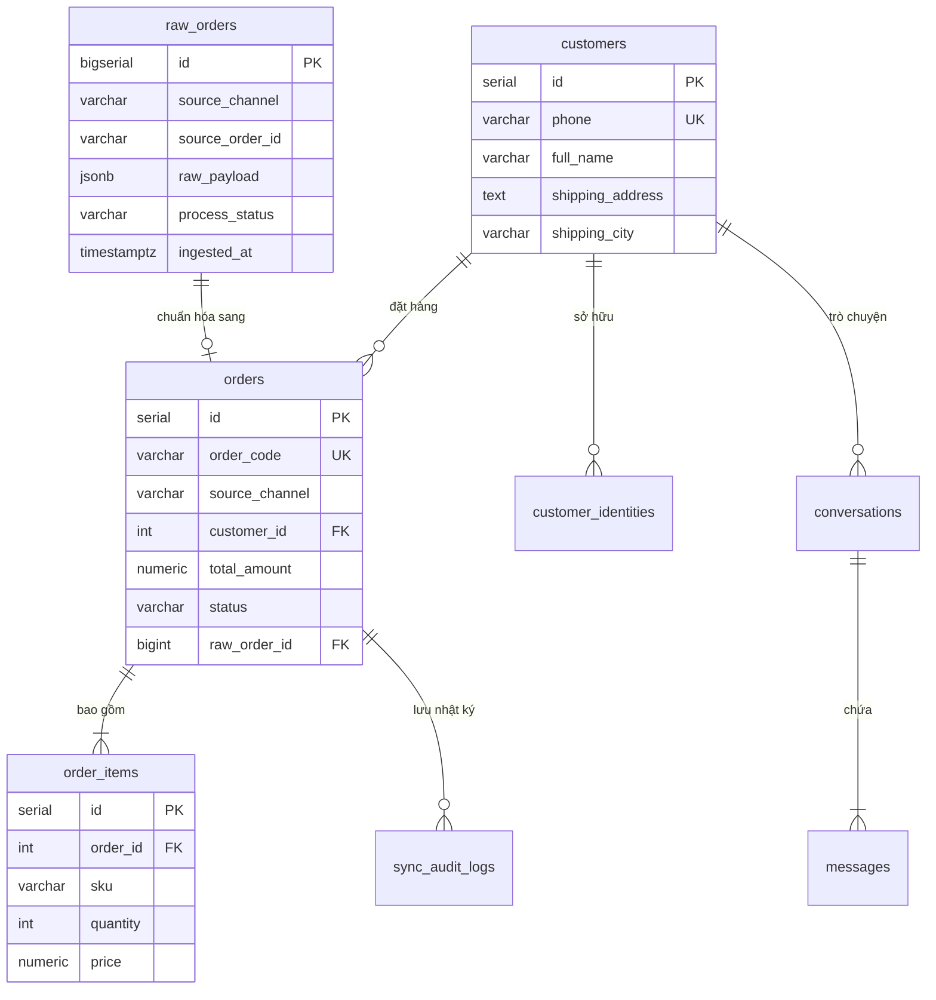

# 📋 SỔ TAY TRIỂN KHAI & KIỂM SOÁT TOÀN DIỆN: GIAI ĐOẠN 0 & GIAI ĐOẠN 1
> **Đề tài**: Xây dựng hệ thống thu thập và chuẩn hóa dữ liệu đơn hàng đa nền tảng  
> **Chuyên ngành**: Công nghệ Thông tin – Học viện Công nghệ Bưu chính Viễn thông (PTIT)  
> **Phạm vi tài liệu**: Tổng hợp toàn bộ Hạ tầng Tech Stack, Môi trường máy thực tế, Thiết kế CSDL Lakehouse, Pipeline gom đơn Landing Page (Giai đoạn 0, 1A và 1B) và Bộ 5 JSON Mock Payload.

---

## 📌 MỤC LỤC
1. [Hiện trạng Môi trường Thực tế trên Máy tính](#1-hiện-trạng-môi-trường-thực-tế-trên-máy-tính)
2. [Hạ tầng Docker Compose (Postgres, Redis, RabbitMQ)](#2-hạ-tầng-docker-compose)
3. [Thiết kế Cơ sở Dữ liệu Lakehouse 10 Bảng](#3-thiết-kế-cơ-sở-dữ-liệu-lakehouse-10-bảng)
4. [Bảng Tiến độ & Kết quả Thực thi Giai đoạn 0 & 1](#4-bảng-tiến-độ--kết-quả-thực-thi)
5. [Bộ 5 File JSON Dữ liệu Mẫu (Mock Payload Đa kênh)](#5-bộ-5-file-json-dữ-liệu-mẫu)
6. [Sổ tay Lệnh Vận hành & Kiểm thử Hàng ngày](#6-sổ-tay-lệnh-vận-hành--kiểm-thử-hàng-ngày)

---

## 1. HIỆN TRẠNG MÔI TRƯỜNG THỰC TẾ TRÊN MÁY TÍNH

| Công cụ / Dịch vụ | Phiên bản / Cấu hình thực tế | Vị trí cài đặt / Cổng truy cập | Trạng thái |
| :--- | :--- | :--- | :---: |
| **Hệ điều hành** | Windows 11 Home 64-bit | Dell Inspiron Laptop (16GB RAM) | ✅ Khỏe mạnh |
| **WSL2 Resource** | `memory=2560MB`, `swap=1GB` | `C:\Users\ADMIN\.wslconfig` | ✅ Đã khóa trần |
| **Python** | `Python 3.14.6 64-bit` | `C:\Users\ADMIN\AppData\Local\Programs\Python\Python314\` | ✅ Sẵn sàng |
| **Git** | `git version 2.55.0.windows.2` | `C:\Program Files\Git\cmd\git.exe` | ✅ Sẵn sàng |
| **IDE** | Antigravity IDE (VS Code Fork) | Đã cấu hình `.vscode/settings.json` trỏ `.venv` | ✅ Sẵn sàng |
| **Docker Desktop** | `Docker 29.8.2` + `Compose v5.5.1` | Chạy 3 container Alpine nhẹ < 600MB RAM | ✅ Đang chạy |
| **Cloudflare Tunnel**| `cloudflared.exe` | `d:\a00_ĐỒ ÁN TỐT NGHIỆP\tools\cloudflared.exe` | ✅ Sẵn sàng |

---

## 2. HẠ TẦNG DOCKER COMPOSE

File cấu hình: `middleware/docker-compose.yml`

```yaml
version: '3.8'

services:
  # 1. Cơ sở dữ liệu chính & Kho gom đơn Lakehouse (~180MB RAM)
  postgres:
    image: postgres:16-alpine
    container_name: gomdon_postgres
    restart: unless-stopped
    environment:
      POSTGRES_DB: gomdon_lakehouse
      POSTGRES_USER: postgres
      POSTGRES_PASSWORD: StrongPassword@2026
    ports:
      - "5432:5432"
    volumes:
      - pgdata:/var/lib/postgresql/data
    deploy:
      resources:
        limits:
          memory: 300M

  # 2. Khóa chống trùng Dedup & Cache Micro-second (~40MB RAM)
  redis:
    image: redis:7-alpine
    container_name: gomdon_redis
    restart: unless-stopped
    command: redis-server --appendonly yes --requirepass RedisPass@2026
    ports:
      - "6379:6379"
    volumes:
      - redisdata:/data
    deploy:
      resources:
        limits:
          memory: 100M

  # 3. Message Broker AMQP Doanh nghiệp & Web Dashboard (~155MB RAM)
  rabbitmq:
    image: rabbitmq:3.13-management-alpine
    container_name: gomdon_rabbitmq
    restart: unless-stopped
    environment:
      RABBITMQ_DEFAULT_USER: admin
      RABBITMQ_DEFAULT_PASS: RabbitAdmin@2026
    ports:
      - "5672:5672"     # Cổng AMQP kết nối backend
      - "15672:15672"   # Cổng Web Dashboard quản lý trực quan
    volumes:
      - rabbitdata:/var/lib/rabbitmq
    deploy:
      resources:
        limits:
          memory: 400M

volumes:
  pgdata:
  redisdata:
  rabbitdata:
```

---

## 3. THIẾT KẾ CƠ SỞ DỮ LIỆU LAKEHOUSE 10 BẢNG

Toàn bộ CSDL được khởi tạo tự động bằng script `middleware/init_db.sql` và `middleware/init_db.py`:



### Chi tiết 10 bảng:
1. `raw_orders` (**Tầng Bronze**): Hứng nguyên bản JSON payload của mọi kênh, bảo đảm không bao giờ mất dữ liệu gốc.
2. `customers` (**Tầng Silver**): Hồ sơ khách hàng gốc, tự động khử trùng theo SĐT (`phone` UNIQUE).
3. `customer_identities` (**Tầng Silver**): Map nick Facebook (PSID), Zalo User ID về cùng một `customer_id`.
4. `orders` (**Tầng Silver**): Đơn hàng chuẩn hóa nội bộ (`ORD_YYYYMMDD_XXXXXX`), lưu trạng thái xử lý kho.
5. `order_items` (**Tầng Silver**): Chi tiết từng SKU, số lượng, đơn giá trong đơn hàng.
6. `conversations` (**Hộp thư chung**): Phiên hội thoại chat đa kênh từ Fanpage và Zalo OA.
7. `messages` (**Hộp thư chung**): Nội dung từng tin nhắn/comment, cờ trích xuất đơn.
8. `sku_mappings` (**Cấu hình sàn**): Bản đồ ánh xạ SKU sàn Shopee/TikTok về SKU kho chung.
9. `channel_configs` (**Cấu hình kênh**): Lưu App ID, App Secret, Token Fanpage/Zalo.
10. `sync_audit_logs` (**Nhật ký kiểm toán**): Ghi log từng lượt đồng bộ đẩy đơn sang ShopTrack phục vụ đối soát & retry.

---

## 4. BẢNG TIẾN ĐỘ & KẾT QUẢ THỰC THI

| Nhiệm vụ (Task) | Nội dung kỹ thuật | Kết quả thực tế trên máy | Trạng thái |
| :--- | :--- | :--- | :---: |
| **TASK 0.1** | Khóa trần RAM WSL2 Windows 11 | File `.wslconfig` trần 2560MB | ✅ Hoàn thành |
| **TASK 0.2** | Cấu trúc thư mục module hóa `app/` | Chia rõ `api/`, `core/`, `schemas/`, `services/`, `workers/` | ✅ Hoàn thành |
| **TASK 0.3** | Khởi chạy 3 container Docker | `gomdon_postgres`, `gomdon_redis`, `gomdon_rabbitmq` đều Up | ✅ Hoàn thành |
| **TASK 0.4** | Khởi tạo CSDL Lakehouse 10 bảng | Chạy `init_db.py`, tạo trọn vẹn 10 bảng trong PostgreSQL | ✅ Hoàn thành |
| **TASK 0.5** | Mock Server ShopTrack API | `mock_shoptrack.py` chạy tại cổng 8001 | ✅ Hoàn thành |
| **TASK 0.6** | Bộ 5 file JSON Mock Payload | Lưu tại `middleware/tests/mock_data/` | ✅ Hoàn thành |
| **TASK 1A** | E2E Direct Flow (POC nhanh) | Form Landing Page gọi trực tiếp ShopTrack thành công trong 300ms | ✅ Hoàn thành |
| **TASK 1B.1** | Cấu hình RabbitMQ Topology | Exchange `orders.exchange` (topic), Queue `orders.inbound.queue` | ✅ Hoàn thành |
| **TASK 1B.2** | Khóa chống click đúp Redis SETNX | Chặn đơn trùng cùng SĐT + SKU trong 30 giây (HTTP 429) | ✅ Hoàn thành |
| **TASK 1B.3** | Gateway Ingestion (< 150ms) | Lưu Tầng Bronze $\rightarrow$ Đẩy RabbitMQ $\rightarrow$ Phản hồi khách siêu tốc | ✅ Hoàn thành |
| **TASK 1B.4** | Async Worker tiêu thụ ngầm | Khử trùng khách hàng $\rightarrow$ Lưu Tầng Silver `orders` & `order_items` | ✅ Hoàn thành |

---

## 5. BỘ 5 FILE JSON DỮ LIỆU MẪU

Lưu trữ tại thư mục: `middleware/tests/mock_data/`

### 1. `landing_page_order.json` (Form đặt hàng trực tiếp):
```json
{
  "full_name": "Nguyễn Văn An",
  "phone": "0987654321",
  "address": "Số 12 Chùa Bộc, Phường Quang Trung",
  "city": "Hà Nội",
  "sku": "TSHIRT-BLK-L",
  "quantity": 2,
  "unit_price": 250000,
  "note": "Giao giờ hành chính, gọi trước khi giao"
}
```

### 2. `facebook_webhook_comment.json` (Comment chứa SĐT trên Livestream/Post):
```json
{
  "entry": [{
    "id": "100234567890123",
    "time": 1728211200,
    "changes": [{
      "field": "feed",
      "value": {
        "item": "comment",
        "verb": "add",
        "comment_id": "987654321098_11223344",
        "post_id": "987654321098",
        "sender_id": "FB_USER_556677",
        "sender_name": "Trần Thu Trang",
        "message": "Cho em lấy 1 áo đen size L nhé shop 0912345678 ship về Cầu Giấy HN",
        "created_time": 1728211200
      }
    }]
  }]
}
```

### 3. `facebook_webhook_message.json` (Tin nhắn Messenger chốt đơn):
```json
{
  "object": "page",
  "entry": [{
    "id": "PAGE_100234567",
    "time": 1728211300,
    "messaging": [{
      "sender": {"id": "PSID_99887766"},
      "recipient": {"id": "PAGE_100234567"},
      "timestamp": 1728211300,
      "message": {
        "mid": "mid.m-123456789abcdef",
        "text": "Mình đặt 1 quần bò size 31, sđt 0905111222, đc: 45 Lê Duẩn, Đà Nẵng nhé"
      }
    }]
  }]
}
```

### 4. `zalo_webhook_message.json` (Tin nhắn Zalo OA kèm địa chỉ & SĐT):
```json
{
  "app_id": "1234567890987654",
  "user_id_by_app": "ZALO_UID_889900",
  "event_name": "user_send_text",
  "timestamp": "1728211400000",
  "sender": {"id": "ZALO_UID_889900"},
  "recipient": {"id": "OA_ID_334455"},
  "message": {
    "msg_id": "zalo_msg_778899",
    "text": "Mình vừa ck cọc đơn áo trắng, ship về 88 Nguyễn Huệ Q1 HCM sđt 0938889999"
  }
}
```

### 5. `shopee_order_webhook.json` (Đơn hàng từ sàn TMĐT):
```json
{
  "shop_id": 998811,
  "order_sn": "241006ABC9988XYZ",
  "order_status": "READY_TO_SHIP",
  "buyer_user": {"name": "Lê Hoàng Long", "phone": "0977665544"},
  "recipient_address": {
    "full_address": "Khu đô thị Văn Quán, Hà Đông, Hà Nội",
    "city": "Hà Nội"
  },
  "item_list": [
    {
      "item_id": 11223344,
      "model_id": 5566,
      "item_sku": "SP-AO-DEN-L",
      "model_quantity_purchased": 1,
      "model_discounted_price": 239000
    }
  ],
  "total_amount": 239000
}
```

---

## 6. SỔ TAY LỆNH VẬN HÀNH & KIỂM THỬ HÀNG NGÀY

### 📌 Lệnh khởi động (Mở 2 Terminal)

#### Terminal 1: Bật Ingestion Gateway (Cổng 8000)
```powershell
cd "d:\a00_ĐỒ ÁN TỐT NGHIỆP\middleware"
.\.venv\Scripts\Activate.ps1
uvicorn app.main:app --port 8000 --reload
```

#### Terminal 2: Bật Async Worker (Xử lý RabbitMQ ngầm)
```powershell
cd "d:\a00_ĐỒ ÁN TỐT NGHIỆP\middleware"
.\.venv\Scripts\Activate.ps1
python -m app.workers.order_consumer
```

---

### 📌 Kiểm tra Dữ liệu & Quản lý Container

1. **Kiểm tra CSDL trực quan trên Web (Cổng 8081)**:
   * Mở trình duyệt vào: **[http://localhost:8081](http://localhost:8081)** (pgweb)
   * Đăng nhập (Host: `postgres`, User: `postgres`, Pass: `StrongPassword@2026`, DB: `gomdon_lakehouse`)
   * Click chuột vào các bảng cần thiết để kiểm tra:
     * `raw_orders`: Kiểm tra dữ liệu JSON thô Tầng Bronze đã được lưu trữ an toàn.
     * `customers`: Kiểm tra hồ sơ khách hàng đã được khử trùng theo SĐT (*"Một khách - Một hồ sơ"*).
     * `orders` & `order_items`: Kiểm tra đơn hàng chuẩn hóa Tầng Silver sẵn sàng xuất kho.

2. **Quản lý Docker**:
   ```powershell
   docker compose up -d    # Bật toàn bộ container (Postgres, Redis, RabbitMQ, pgweb)
   docker compose ps       # Xem trạng thái hoạt động
   docker compose stop     # Dừng container khi nghỉ làm việc
   docker compose start    # Bật lại container đã dừng
   ```

> 💡 *Ghi chú: Danh mục chi tiết các cổng truy cập (Port Directory) được lưu tập trung tại [cau_truc_du_an.md](cau_truc_du_an.md) và [README.md](../middleware/README.md).*
